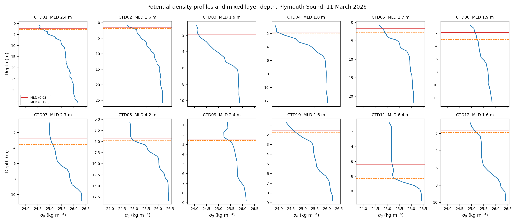
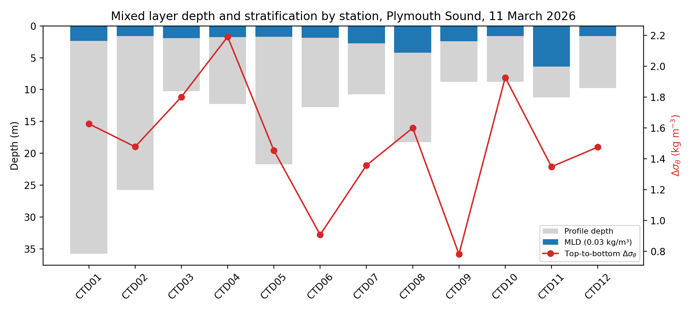

# Plymouth Sound hydrography: mixed layer depth from CTD profiles

Mixed layer depth (MLD) and stratification at 12 CTD stations in Plymouth Sound, UK, from fieldwork on 11 March 2026 (MAR538 Marine Environmental Monitoring, University of Plymouth).

## Key result
The water column was strongly stratified by salinity at every station. The mixed layer was shallower than 3 m at 10 of 12 stations (median 1.9 m), even though the water was 9-36 m deep. Fresher surface water (salinity 31.1-33.1) sat over saltier bottom water (33.7-34.5), giving top-to-bottom potential density differences of 0.8-2.2 kg/m³. Only CTD08 (4.2 m) and CTD11 (6.4 m) had a clearly deeper surface mixed layer.




## Data
- 12 SeaBird CTD downcasts (`data/ctd/*.cnv`), 09:45-12:43 UTC on 11 March 2026
- Variables used: depth, temperature, practical salinity

## Method
1. **Cleaning:** records shallower than 0.5 m were removed. These were taken in air or before the sensor equilibrated and show near-zero salinity.
2. **Density:** potential density anomaly (σθ) was computed with TEOS-10 (`gsw`).
3. **Binning:** profiles were averaged into 0.5 m depth bins.
4. **MLD:** the depth where σθ first exceeds its value at a 1.5 m reference depth by 0.03 kg/m³ (de Boyer Montégut et al., 2004), with linear interpolation.
5. **Sensitivity:** repeated with a 0.125 kg/m³ threshold (Monterey and Levitus, 1997) and with 1.0 m and 2.0 m reference depths.

**Why a 1.5 m reference instead of the usual 10 m?** Most stations were only 9-13 m deep, so a 10 m reference is not usable. 1.5 m sits below the thin, noisy surface layer affected by the ship and sensor entry.

## Results (`mld_results.csv`)

| Station | Depth (m) | Surface S | Bottom S | Δσθ (kg/m³) | MLD 0.03 (m) | MLD 0.125 (m) |
|---|---|---|---|---|---|---|
| CTD01 | 35.8 | 32.04 | 34.14 | 1.63 | 2.37 | 2.65 |
| CTD02 | 25.8 | 32.26 | 34.15 | 1.48 | 1.57 | 1.81 |
| CTD03 | 10.3 | 31.46 | 33.76 | 1.80 | 1.92 | 2.31 |
| CTD04 | 12.3 | 31.13 | 33.96 | 2.19 | 1.78 | 1.93 |
| CTD05 | 21.8 | 32.18 | 34.05 | 1.45 | 1.72 | 2.80 |
| CTD06 | 12.8 | 32.57 | 33.72 | 0.91 | 1.86 | 2.95 |
| CTD07 | 10.8 | 32.60 | 34.34 | 1.36 | 2.74 | 3.54 |
| CTD08 | 18.3 | 32.41 | 34.46 | 1.60 | 4.23 | 4.79 |
| CTD09 | 8.8 | 33.10 | 34.11 | 0.78 | 2.43 | 2.58 |
| CTD10 | 8.8 | 31.78 | 34.22 | 1.93 | 1.57 | 1.77 |
| CTD11 | 11.3 | 32.74 | 34.47 | 1.35 | 6.36 | 8.31 |
| CTD12 | 9.8 | 32.56 | 34.45 | 1.48 | 1.60 | 1.88 |

## Interpretation
Textbook UK shelf seas are often well mixed in late winter. Plymouth Sound on 11 March 2026 was not. The salinity contrast points to freshwater input from the Tamar and Plym estuaries after a wet winter, with 521 mm of rain recorded in Plymouth from January to March 2026. Fresh water floats on the denser sea water and suppresses mixing, the same mechanism that creates barrier layers in river-influenced seas such as the Bay of Bengal.

## Limitations
- **Many MLDs sit close to the reference depth.** At most stations density increased steadily from near the surface, so there was no well-defined mixed layer and the MLD moved with the chosen reference depth (see `mld_0.03_ref1.0/1.5/2.0` in `mld_results.csv`). The values at CTD01, CTD07, CTD08, CTD09 and CTD11 (1.5 m and 2.0 m references) were robust to this choice.
- **One day, one survey:** a snapshot on a single tidal state, not a seasonal picture.
- **The freshwater explanation is an interpretation.** River flow and rainfall were not formally related to each profile.

## Reproduce
```
pip install numpy pandas gsw matplotlib
python mld_analysis.py
```

## References
- de Boyer Montégut, C., Madec, G., Fischer, A.S., Lazar, A. and Iudicone, D. (2004) Mixed layer depth over the global ocean: an examination of profile data and a profile-based climatology. *Journal of Geophysical Research: Oceans*, 109, C12003.
- Monterey, G. and Levitus, S. (1997) *Seasonal variability of mixed layer depth for the world ocean*. NOAA Atlas NESDIS 14.
- McDougall, T.J. and Barker, P.M. (2011) *Getting started with TEOS-10 and the Gibbs Seawater (GSW) Oceanographic Toolbox*. SCOR/IAPSO WG127.
